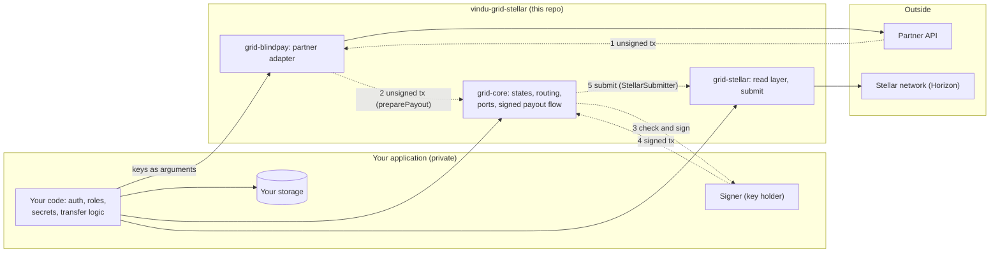

# vindu-grid-stellar

Open-source toolkit for settling cross-border payments on Stellar. It holds the partner clients, the two-leg transfer core and the Stellar layer that Vindú Grid uses to move money from Brazil through USDC on Stellar.

> **Status: early, 0.x.** This repository is being built as part of Vindú's Stellar Community Fund project. No package is on npm yet: install from a git tag. See the [stability policy](#stability).

## Why it exists

Vindú is a cross-border payments platform for Brazil. Its partners are VASPs operating under the Banco Central do Brasil transition regime, and they hold the accounts and the funds. Vindú is the technology layer on top of them and never custodies client funds.

Every Vindú transfer runs in two legs: fiat to USDC, then USDC to fiat. Stellar is the default rail between the two. The pieces that make this work are useful to any fintech or VASP doing the same thing, so they live here, in the open:

- typed clients for partner APIs that settle USDC on Stellar, starting with BlindPay;
- the core of a two-leg transfer: states, routing rules and price tolerance;
- the Stellar layer: following accounts on Horizon, reconciling on-chain payments with partner data, and decoding, submitting and looking up signed transactions;
- later, an open-source Soroban registry for transfer and verification attestations.

## What it is not

- **Not a Vindú API.** Nothing here calls Vindú. It gives no access to Vindú's accounts, clients or transfers.
- **Not a custody solution.** The library never holds a signing key. It passes the partner's unsigned transaction to your signer and submits what your signer returns.
- **Not an auth layer.** There are no users, sessions or roles here. Your application decides who may do what before it calls this code.

## How it fits in an application



Your application authenticates the user, checks permissions, reads its own secrets and stores its own data. It then calls the three packages with plain, already authorized inputs, and wires them together: the partner adapter and the Stellar submitter are passed to core's payout flow through core's interfaces, so core itself never imports a partner or the Stellar SDK.

For a payout that needs a signature, the partner builds the unsigned transaction and the adapter returns it (1, 2). Core checks the quote and the transfer state and hands the transaction to your signer, which checks it again and signs (3, 4). The Stellar layer submits it and reports what happened (5). Only then is the partner told.

## Design rules

- **Bring your own credentials.** Partner keys and URLs are passed as arguments. The library never reads environment variables.
- **Typed in, typed out.** Every call takes a typed input and returns a typed result or a typed error.
- **Nothing sensitive in logs.** An optional `onCall` hook reports the method, path, status and timing of each partner call. It never includes keys or request and response bodies.
- **Unsigned in, checked, signed once.** Payouts that need a signature come from the partner as unsigned Stellar transactions. Your signer must check the transfer state, the network, the source, the destination, the asset, the exact amount, the fee, the time bound and the absence of other preconditions before it signs. `assertPayoutXdrMatches` in `@vindu/grid-stellar` makes the transaction checks without a key; the test signer in `examples/testnet-demo` calls it.
- **One adapter interface.** Every partner client implements the same core interface. A shared conformance suite that every adapter must pass is **planned** for tranche 3, as part of the integration kit for Stellar-ready VASPs. It does not exist yet.

## Safety rules

These rules decide when money may move. The packages enforce them where they can, and your application must follow them where it decides.

- **Never pay out more than was funded.** `runSignedPayout` takes `funded`, the amount confirmed in the client's account. The quote must move a positive amount of that same asset (code and issuer), no more than `funded`, before anything is authorized; only then is it the amount the signer expects.
- **Authorize before the transfer waits for a signature.** The payout runs from `payout_quoted`, and the transfer moves to `awaiting_signature` only once the partner's authorization exists. A failed authorization goes `payout_quoted -> needs_attention`, and a quote that runs out first goes back to `funded`; nothing was signed either way.
- **Store `awaiting_signature` as a compare-and-set.** `onAuthorized` moves `payout_quoted -> awaiting_signature` only if the transfer is still in `payout_quoted` (for example `UPDATE ... WHERE id = ? AND state = 'payout_quoted'`), and throws when another run got there first. Two runs for one transfer then cannot both sign. A store that cannot compare and set must lock the transfer for the whole run.
- **Sign once.** For a payout quote the signer is called at most once. If the quote gets too close to its expiry before the signed transaction leaves, the transaction is dropped unsubmitted: get a fresh quote and a new transaction. An old transaction is never signed again.
- **Sign a replacement only when the first can never land.** That is only after `failed` (the transaction is in a ledger as failed: nothing moved) or `expired_not_landed`. `expired_not_landed` is judged by Horizon, never by your clock, and needs the sequence proof: a ledger closed after the transaction's time limit; the transaction's source account, read from a Horizon that had ingested at least that ledger (its `Latest-Ledger` header), still has a sequence number below the transaction's, so the transaction neither landed nor can land; and every hash lookup succeeded and found nothing. This holds on a re-run of the same envelope and on a Horizon that pruned old history. After `unknown` or `rejected` the first transaction could still land, so check again later and do not sign again.
- **Pay only a destination you configured.** The account a payout pays comes from the partner in writing and is configured in your application, never read from the transaction the partner returns: that transaction is what the signer checks against it. For BlindPay, set the adapter's `payoutDestination`; `runStellarPayout` refuses a run with no destination, or with a `signing.destination` that differs from it.
- **Use one Horizon you trust for submit and lookup.** Point the submitter at one consistent Horizon instance that you operate or trust, never at a public load-balanced URL such as the ones in `STELLAR_TESTNET` and `STELLAR_MAINNET`. Behind a load balancer the reads can reach instances at different ledgers, so a landed transaction can look missing. The submitter then answers `unknown`, not a false expiry, but the payout stops for a person. A replacement is allowed only with the sequence proof above.
- **Store the move before the partner is told.** When you submit, only a `success` outcome goes on. `onSubmitted` then stores `awaiting_signature -> payout_submitted`, and only after that is the partner payout created. If storing fails, the money has still moved: store `payout_submitted` (if it is already stored, the store committed before it failed, so leave it), then call `retryPayoutExecute` with the pending body and key. Never re-quote. When the partner submits instead (`partner_submits`), the move on success is `awaiting_signature -> payout_submitted` with the reason `sent_to_partner`: nobody has seen that transaction on chain yet.
- **Every stop after `awaiting_signature` has an edge.** Once `onAuthorized` stored `awaiting_signature`, an error with no edge of its own (a hook that throws, a clock that breaks) is `PayoutInterruptedError`: take `awaiting_signature -> needs_attention` (`run_interrupted`), and never sign again for that quote.
- **The partner and the chain must agree before funding counts.** A transfer is `funded` only when the payment is on Stellar, matches the leg (account, asset and issuer, exact amount), and the partner's amount and the on-chain amount agree.
- **No automatic refund or reroute.** When something does not add up, the transfer moves to `needs_attention` and waits for a person. Nothing here refunds, reroutes or re-signs on its own, and the route never changes once the funding leg exists.

## Packages

| Package | Contents | Status |
|---|---|---|
| [`@vindu/grid-core`](packages/grid-core) | Types, transfer states, routing rules, partner adapter and submitter interfaces, signed payout flow | 0.1.0, git tag only |
| [`@vindu/grid-blindpay`](packages/grid-blindpay) | BlindPay client and adapter: customers, wallets, pay-ins, payouts, webhooks | 0.1.0, git tag only |
| [`@vindu/grid-stellar`](packages/grid-stellar) | Horizon read layer, payment matching, account checks, submit of signed transactions | 0.1.0, git tag only |
| `contracts/registry` | Soroban contract for transfer and verification attestations | Planned (tranche 2) |
| Integration kit | Shared test doubles (fake Horizon, mock partner) and the adapter conformance suite | Planned (tranche 3) |
| [`examples/testnet-demo`](examples/testnet-demo) | End-to-end two-leg transfer on Stellar with a mock partner, offline | Example, not packaged |

## Getting started

Requirements: Node 22.12 or later, and Yarn 4 through corepack.

```sh
corepack enable
yarn install
yarn build
yarn test
```

Then run the demo, a full two-leg transfer with mock partners and an in-memory Horizon. It runs offline and needs no credentials:

```sh
yarn workspace testnet-demo start
```

## Stability

The packages follow a 0.x policy until 1.0:

- A breaking change bumps the minor version (`0.1.x` to `0.2.0`). A patch version (`0.1.0` to `0.1.1`) never breaks the API.
- All three packages share one version and are tagged together. Use the same tag for every package.
- From 1.0 on, the packages follow semantic versioning.

## Install from a git tag

The packages are not on npm yet. Install them from the repository's git tag (`v0.1.0`) with Yarn 4. Add both blocks to your `package.json`:

```json
{
  "dependencies": {
    "@vindu/grid-core": "https://github.com/Vindu-org/vindu-grid-stellar.git#workspace=@vindu/grid-core&tag=v0.1.0",
    "@vindu/grid-blindpay": "https://github.com/Vindu-org/vindu-grid-stellar.git#workspace=@vindu/grid-blindpay&tag=v0.1.0",
    "@vindu/grid-stellar": "https://github.com/Vindu-org/vindu-grid-stellar.git#workspace=@vindu/grid-stellar&tag=v0.1.0"
  },
  "resolutions": {
    "@vindu/grid-core": "https://github.com/Vindu-org/vindu-grid-stellar.git#workspace=@vindu/grid-core&tag=v0.1.0"
  }
}
```

- Yarn clones the repository at the tag and packs each workspace; packing builds it, so you get the compiled `dist/`, the README and the license.
- Keep the `resolutions` entry. `grid-blindpay` and `grid-stellar` depend on `@vindu/grid-core@^0.1.0`, and without it Yarn would look that name up on the npm registry, where it does not exist (or could belong to someone else). The resolution also keeps a single copy of core, so its error classes work with `instanceof` across packages.
- Do not install `@vindu/...` by a semver range from npm. The maintainers must claim the `@vindu` npm scope before any registry install is supported; until then, a package under that name on npm is not from this project.
- Use the same tag on every line. Leave out the packages you do not need, but keep `grid-core` and the resolution.
- npm and pnpm cannot install one workspace from a git URL. Pack the packages instead (`yarn workspace @vindu/grid-core pack`, and so on) and install the tarballs, pinning `@vindu/grid-core` to its tarball with `overrides`.

Requirements:

- Node 22.12 or later for `grid-stellar`: the Stellar SDK it loads needs `require()` of ES modules. `grid-core` and `grid-blindpay` run on Node 22 or later.
- The packages are CommonJS with type declarations, and each has one entry point (an `exports` map): import from the package name only. Files under `dist/` are internal and cannot be imported directly.

CI checks the packed-tarball path on every change: `scripts/check-consumption.sh` packs the three packages, installs the tarballs into a clean project with the resolution above and with install scripts turned off (`enableScripts: false`), loads each one with `require()` and type-checks a file that imports them, with TypeScript `moduleResolution` set to `node` and to `node16`. CI does not install from the git tag; that path was verified by hand.

## Roadmap

| Tranche | Scope in this repository | Target |
|---|---|---|
| 1. Testnet | Core, BlindPay client, Stellar read layer, testnet demo | 31 Jan 2027 |
| 2. Production | Soroban registry for transfer and verification attestations, threat model, metrics | 15 Mar 2027 |
| 3. Mainnet | Stellar-ready VASP integration kit with conformance tests, hardening | 30 Apr 2027 |

## Security

Please do not open public issues for security problems. Use **Report a vulnerability** in this repository's Security tab, which reaches the maintainers privately.

Never paste API keys, signing keys or client data into issues, pull requests or test fixtures.

## Contributing

The project is at an early stage. Issues and questions are welcome. Pull requests will be easier to review after the first release, once the package layout is stable.

## License

[Apache License 2.0](LICENSE). Maintained by Vindú and provided as is.
