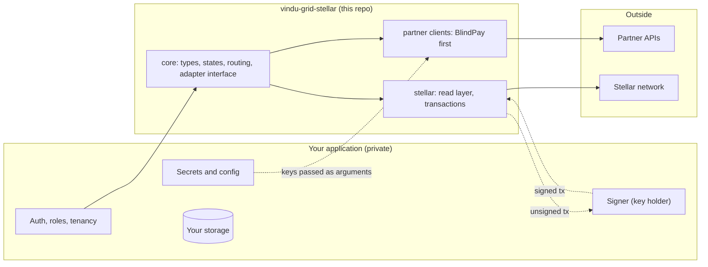

# vindu-grid-stellar

Open-source toolkit for settling cross-border payments on Stellar. It holds the partner clients, the two-leg transfer core and the Stellar layer that Vindú Grid uses to move money from Brazil through USDC on Stellar.

> **Status: early.** This repository is being built as part of Vindú's Stellar Community Fund project. No package is published yet, and every API here will change before the first release.

## Why it exists

Vindú is a cross-border payments platform for Brazil. Its partners are VASPs operating under the Banco Central do Brasil transition regime, and they hold the accounts and the funds. Vindú is the technology layer on top of them and never custodies client funds.

Every Vindú transfer runs in two legs: fiat to USDC, then USDC to fiat. Stellar is the default rail between the two. The pieces that make this work are useful to any fintech or VASP doing the same thing, so they live here, in the open:

- typed clients for partner APIs that settle USDC on Stellar, starting with BlindPay;
- the core of a two-leg transfer: states, routing rules and price tolerance;
- the Stellar layer: following accounts on Horizon, reconciling on-chain payments with partner data, and building and submitting transactions;
- later, an open-source Soroban registry for transfer and verification attestations.

## What it is not

- **Not a Vindú API.** Nothing here calls Vindú. It gives no access to Vindú's accounts, clients or transfers.
- **Not a custody solution.** The library never holds a signing key. It hands out unsigned transactions and accepts signed ones.
- **Not an auth layer.** There are no users, sessions or roles here. Your application decides who may do what before it calls this code.

## How it fits in an application

Your application authenticates the user, checks permissions, reads its own secrets and stores its own data. It then calls this library with plain, already authorized inputs. The library talks to partner APIs and to Stellar and returns typed results.

## Design rules

- **Bring your own credentials.** Partner keys and URLs are passed as arguments. The library never reads environment variables.
- **Typed in, typed out.** Every call takes a typed input and returns a typed result or a typed error.
- **Nothing sensitive in logs.** An optional `onCall` hook reports the method, path, status and timing of each partner call. It never includes keys or request and response bodies.
- **Unsigned out, signed in.** Payouts that need a signature come back as unsigned Stellar transactions. Your signer should check the amount, the destination and the transfer state before it signs.
- **One adapter interface.** Every partner client implements the same interface and passes the same conformance tests. That suite is the integration kit for Stellar-ready VASPs.

## Packages

| Package | Contents | Status |
|---|---|---|
| [`@vindu/grid-core`](packages/grid-core) | Types, transfer states, routing rules, partner adapter interface | 0.1.0, unreleased |
| [`@vindu/grid-blindpay`](packages/grid-blindpay) | BlindPay client: accounts, pay-ins, payouts, Stellar payout flow | 0.1.0, unreleased |
| [`@vindu/grid-stellar`](packages/grid-stellar) | Horizon read layer, reconciliation, transaction submit | 0.1.0, unreleased |
| `contracts/registry` | Soroban contract for transfer and verification attestations | Planned (tranche 2) |
| [`examples/testnet-demo`](examples/testnet-demo) | End-to-end two-leg transfer on Stellar with a mock partner, offline | 0.1.0, unreleased |

## Roadmap

| Tranche | Scope in this repository | Target |
|---|---|---|
| 1. Testnet | Core, BlindPay client, Stellar read layer, testnet demo | 31 Jan 2027 |
| 2. Production | Soroban registry for transfer and verification attestations, threat model, metrics | 15 Mar 2027 |
| 3. Mainnet | Stellar-ready VASP integration kit with conformance tests, hardening | 30 Apr 2027 |

## Security

Please do not open public issues for security problems. Use **Report a vulnerability** in this repository's Security tab, which reaches the maintainers privately.

Never paste API keys, signing keys or client data into issues, pull requests or test fixtures.

## Contributing

The project is at an early stage. Issues and questions are welcome. Pull requests will be easier to review after the first release, once the package layout is stable.

## License

[Apache License 2.0](LICENSE). Maintained by Vindú and provided as is.
